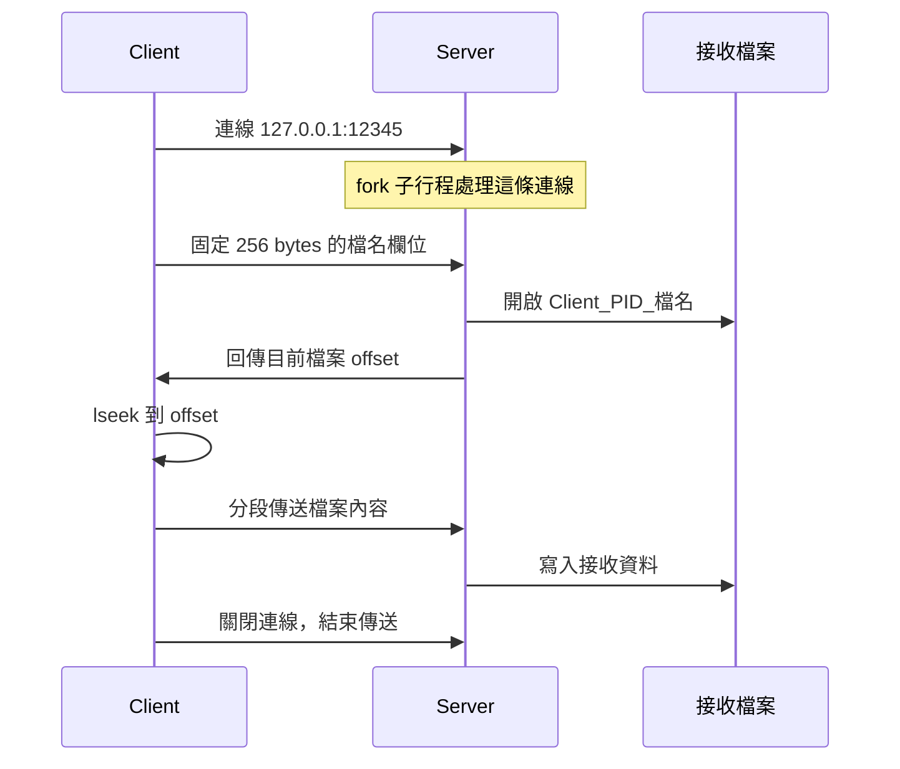

# 作業一：TCP 檔案傳送

Client 讀取工作目錄的 `homework.txt`，透過 TCP 傳給本機 Server。Server 為每條連線建立子行程，以 `Client_<PID>_homework.txt` 命名接收結果，讓不同連線各自存檔。

## 連線流程



檔名欄位以 NUL 結尾，不足 256 bytes 的部分補零；公開版只接受英文字母、數字、底線、連字號與句點。offset 直接使用本機 `long long` 的記憶體表示，Client 與 Server 應在相同架構執行。它還沒有轉為可跨架構交換的固定端序格式。

## 執行

先在 repository 根目錄執行 `make`。

```bash
mkdir -p run/server run/client
cp examples/homework.txt run/client/homework.txt
```

開啟終端機 A，從 repository 根目錄執行：

```bash
cd run/server
../../build/bin/tcp_server
```

開啟終端機 B，從 repository 根目錄執行：

```bash
cd run/client
../../build/bin/tcp_client
```

回到 repository 根目錄，用 `sha256sum` 比對輸入與接收檔案。重複執行 Client 會產生另一個帶 PID 的檔案。

```bash
sha256sum run/client/homework.txt run/server/Client_*_homework.txt
```

`tcp_client` 沒有命令列參數。要測試其他內容，請把測試檔放進 `run/client/` 並命名為 `homework.txt`。結束時在 Server 的終端機按 `Ctrl+C`。

## 從程式看什麼

- [try.cpp](../ConsoleApplication/ConsoleApplication/try.cpp)：監聽、接受連線、`fork()`、接收檔案；父行程關閉已交給子行程的連線 socket。
- [client.cpp](../ConsoleApplication/ClientApplication/client.cpp)：讀取檔案、交換 offset、`lseek()`、上傳內容。
- [io_helpers.h](../ConsoleApplication/io_helpers.h)：`read_exact()` 與 `write_all()`；一次系統呼叫不足時繼續讀寫，遇到 `EINTR` 重試。

原先只有單次 `read()`／`write()`，不能假設一個 TCP 欄位恰好由一次呼叫讀完。公開整理版補上這個處理，也把 Client 缺檔、握手失敗與傳送錯誤改為非零退出狀態。

## 尚未完成的部分

課程需求包含續傳，但目前多人連線版把 PID 放進檔名。重連後子行程通常有不同 PID，Server 會建立另一個檔案，因此交換 offset 並不等於已完成可靠續傳。若要補齊，需要讓傳輸身分與檔名在重連後仍可對應，並確認原檔內容一致。

目前也沒有檔案總長度、接收完成確認或內建 checksum。Client 正常退出只表示資料已交給本機 socket；是否完整落盤，應以接收檔案的大小與雜湊驗證。程式使用 64 位元 offset，但測試目前只涵蓋空檔與約 1 MiB 的二進位資料，未驗證 4 GB 以上檔案或實際斷線後恢復。

原始版 Client 的短檔名欄位與本次固定 256 bytes 的格式不同，請使用同一次編譯產生的 Client／Server。
